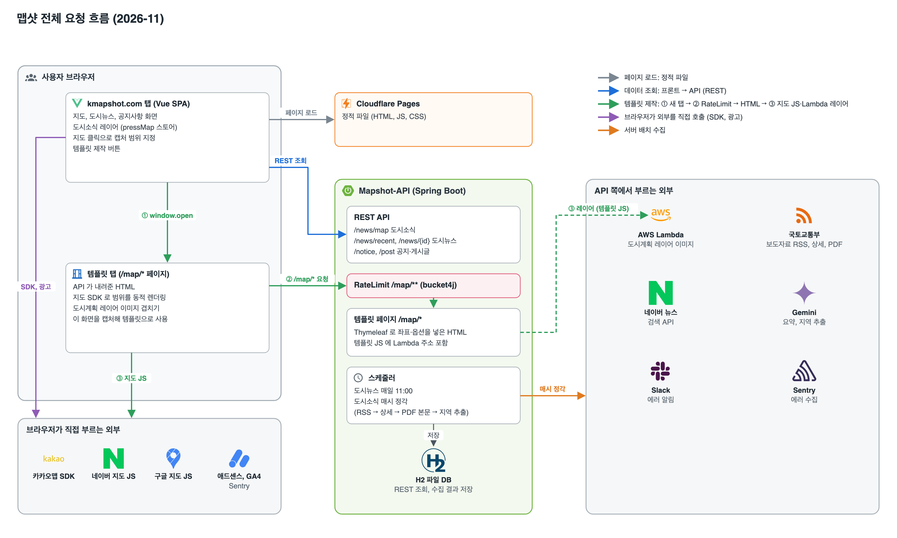
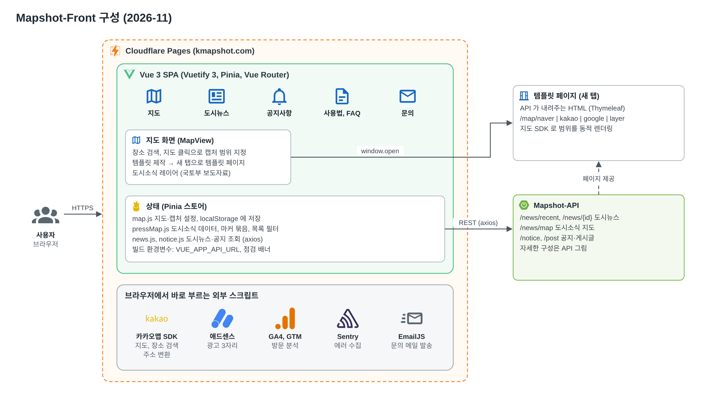
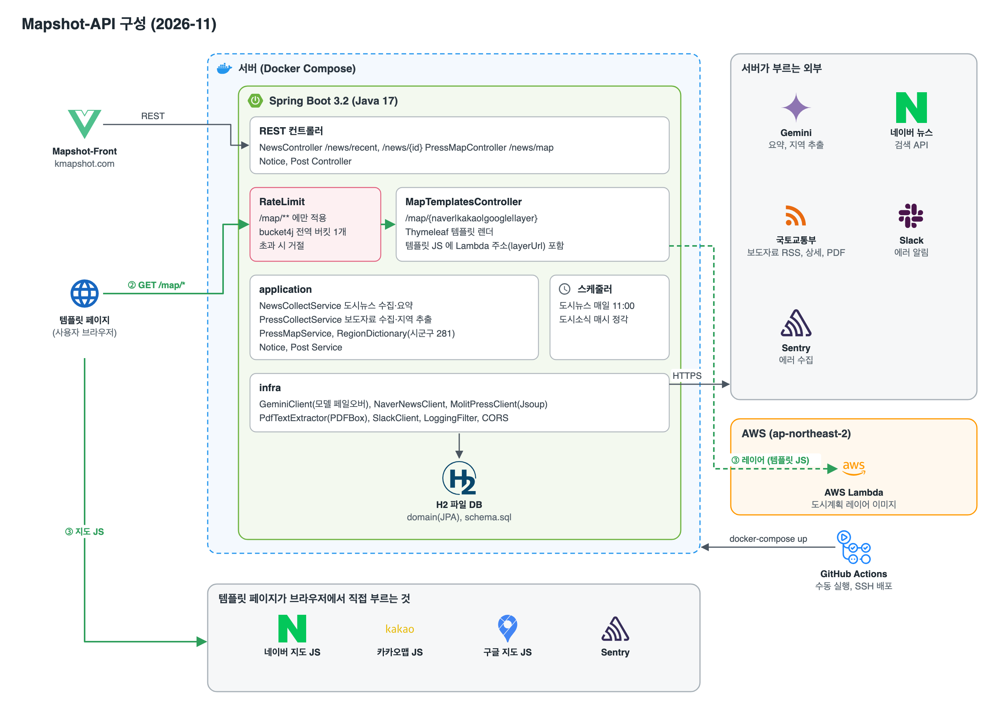

# 아키텍처 개요

> 2026-11-25 기준. 코드와 각 레포 README 를 보고 정리했다. 운영 환경 세부는 `확인 필요` 로 표시한 부분이 있다.

## 그림

- [전체 요청 흐름](diagrams/mapshot-flow.png): 프론트·API·외부를 한 화면에 두고 요청 종류별로 색을 나눈 그림. 원본 [mapshot-flow.drawio](diagrams/mapshot-flow.drawio)
- [Mapshot-Front 구성](diagrams/mapshot-front.png) · 원본 [mapshot-front.drawio](diagrams/mapshot-front.drawio)
- [Mapshot-API 구성](diagrams/mapshot-api.png) · 원본 [mapshot-api.drawio](diagrams/mapshot-api.drawio)

`.drawio` 는 draw.io(app.diagrams.net 또는 데스크톱 앱)에서 바로 열어 고칠 수 있다. 아이콘은 파일 안에 들어 있다.
처음 그림은 `diagrams/generate.py` 로 만들었지만, 이후엔 draw.io 에서 직접 고치고 PNG 를 다시 내보내면 된다
(파일 > 내보내기 > PNG, 배율 2).



| 색 | 흐름 | 누가 누구를 부르나 |
|---|---|---|
| 회색 | 페이지 로드 | 브라우저 → Cloudflare Pages (정적 파일) |
| 파랑 | 데이터 조회 | SPA → API REST (`/news/*`, `/notice`, `/post`) |
| 초록 | 템플릿 제작 | ① SPA 가 새 탭을 연다 → ② 새 탭이 API `/map/*` 를 부른다. RateLimit 을 통과하면 Thymeleaf HTML 을 내려준다 → ③ 그 HTML 의 JS 가 지도 JS SDK 와 AWS Lambda 레이어 이미지를 부른다. Lambda 주소는 API 템플릿에 들어 있어 그림에선 API 쪽에 붙였다(점선). 실제 요청은 브라우저에서 나간다 |
| 보라 | 브라우저 직접 호출 | SPA → 카카오맵 SDK, 애드센스, GA4, Sentry (API 를 거치지 않음) |
| 주황 | 서버 배치 | API 스케줄러 → 국토부·네이버 뉴스·Gemini (사용자 요청과 무관) |





## 한눈에

```
 사용자 브라우저
   │
   ├─ kmapshot.com ───────────── Mapshot-Front (Vue 3 정적 빌드, Cloudflare Pages)
   │     ├─ 카카오맵 JS SDK (지도·장소 검색·주소 변환, 브라우저에서 직접)
   │     ├─ 캡처 범위 계산 (mapshot.min.js) → 템플릿 제작은 새 탭으로 API 템플릿 페이지(/map/*)
   │     └─ 애드센스
   │
   └─ API 호출 ─────────────────── Mapshot-API (Spring Boot, Docker)
         ├─ H2 파일 DB (schema.sql)
         ├─ 스케줄러
         │    ├─ 도시뉴스 수집·요약 (매일 11:00) ── 네이버 뉴스 검색 API, Gemini
         │    └─ 도시소식 지도 수집 (매시 정각) ── 국토교통부 보도자료 RSS·PDF, Gemini
         └─ Slack(에러 알림), Sentry
```

## Mapshot-Front

- Vue 3, Vuetify 3, Pinia, Vue Router, Vue CLI 빌드. Cloudflare Pages 로 배포.
- 주요 화면
  - 지도(`MapView`): 위치 검색 → 지도 클릭으로 캡처 범위 지정 → 템플릿(위성 이미지) 제작. 오른쪽에 반경·지도 종류·출력 회사 설정.
    - 도시소식 레이어: 왼쪽 패널 버튼으로 켠다. `plans/2026-11-city-news-map/`
  - 도시뉴스(`/news`): LLM 이 매일 묶어 쓴 브리핑. `plans/2026-06-news-ai-digest/`
  - 공지사항, 사용법, FAQ
- 상태: Pinia 스토어(`store/map.js`, `news.js`, `notice.js`, `pressMap.js` 등). 지도 설정 일부는 localStorage 에 저장.
- 빌드 환경변수: `VUE_APP_API_URL`, 점검 배너(`VUE_APP_MAINTENANCE_*`, `decisions/2026-11-25-maintenance-banner.md`).

## Mapshot-API

- Java 17, Spring Boot 3.2, Spring Data JPA, H2(파일). Docker 이미지로 배포(`docker-compose`).
  - 배포 대상: GitHub Actions 워크플로 기준 OCI(SSH 배포) — 확인 필요(README 에는 AWS EC2 로 적혀 있음)
- 패키지 구조: `presentation`(컨트롤러) / `application`(기능 서비스) / `domain`(엔티티·리포지토리) / `infra`(외부 클라이언트·설정·인증·로깅)
- 주요 기능
  - 지도 템플릿 `/map/{naver|kakao|google|layer}`: 요청 → `RateLimitInterceptor`(bucket4j, `/map/**` 에만, IP 별이 아닌 전역 버킷 1개) → `MapTemplatesController` 가 Thymeleaf 템플릿을 렌더
  - 도시뉴스: `/news/recent`, `/news/{id}`
  - 도시소식 지도: `/news/map?days=`
  - 공지사항, 게시글
- 외부 연동
  - Gemini(Google AI Studio) 직접 호출, 모델 페일오버(`client.gemini.models`)
  - 네이버 뉴스 검색 API
  - 국토교통부 보도자료 RSS·상세 페이지(Jsoup), PDF 첨부(Apache PDFBox)
  - Slack 웹훅, Sentry
- 스키마: `schema.sql` 이 매 기동 때 실행(`spring.sql.init.mode: always`).

## 관련 서비스

- `blog.kmapshot.com`: 운영 이슈 기록 블로그

## 데이터 흐름 예시

- 템플릿 제작: 지도 화면에서 '템플릿 제작'을 누르면 새 탭으로 API 의 `/map/{naver|kakao|google|layer}` 페이지를 연다.
  API 는 Thymeleaf 로 좌표·반경·옵션을 넣은 HTML 을 내려주고, 그 페이지가 브라우저에서 각 지도 JS SDK 로 범위를 동적 렌더링한다.
  도시계획 레이어 이미지는 템플릿 페이지의 JS 가 AWS Lambda 에서 받아 지도 위에 겹친다.
- 도시소식 지도: `plans/2026-11-city-news-map/flow.md`
