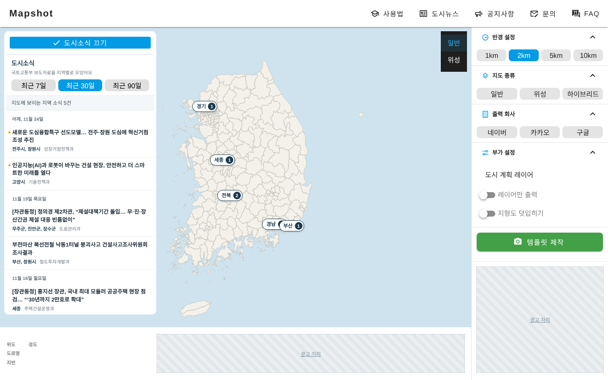
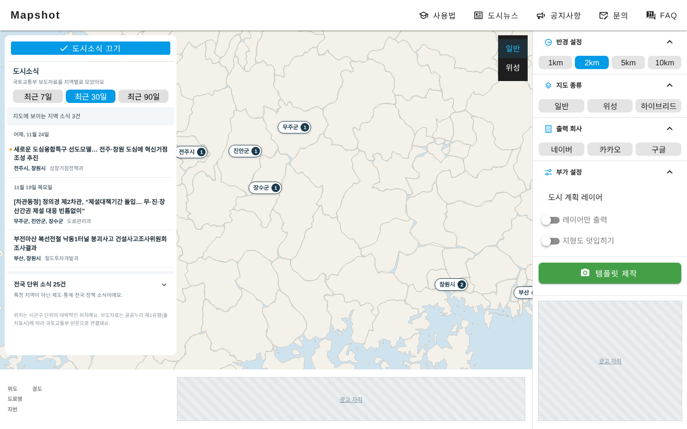
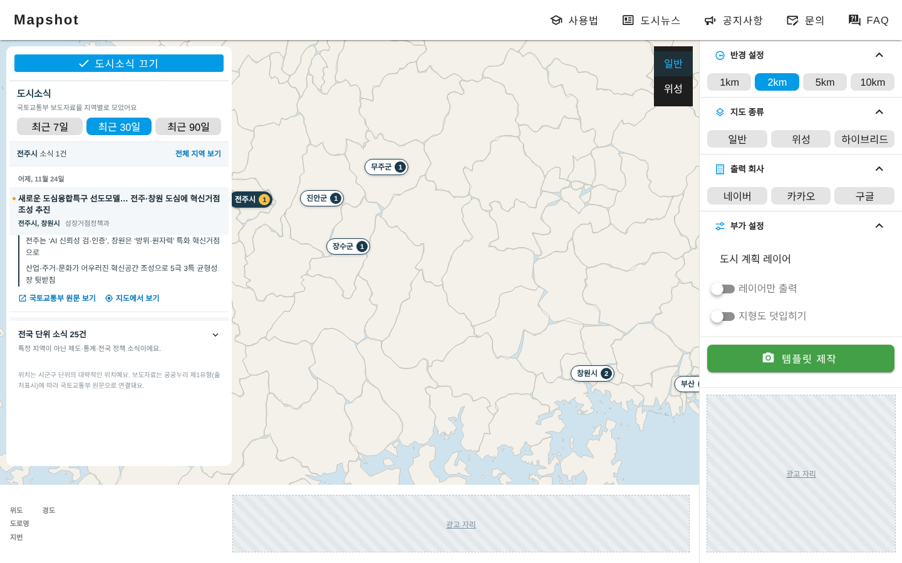
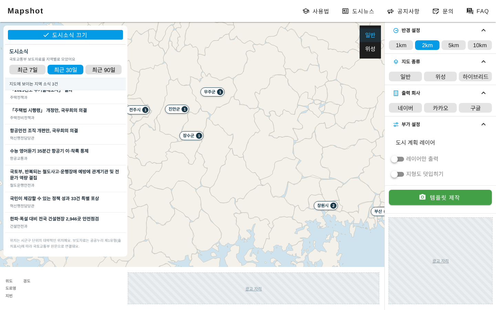
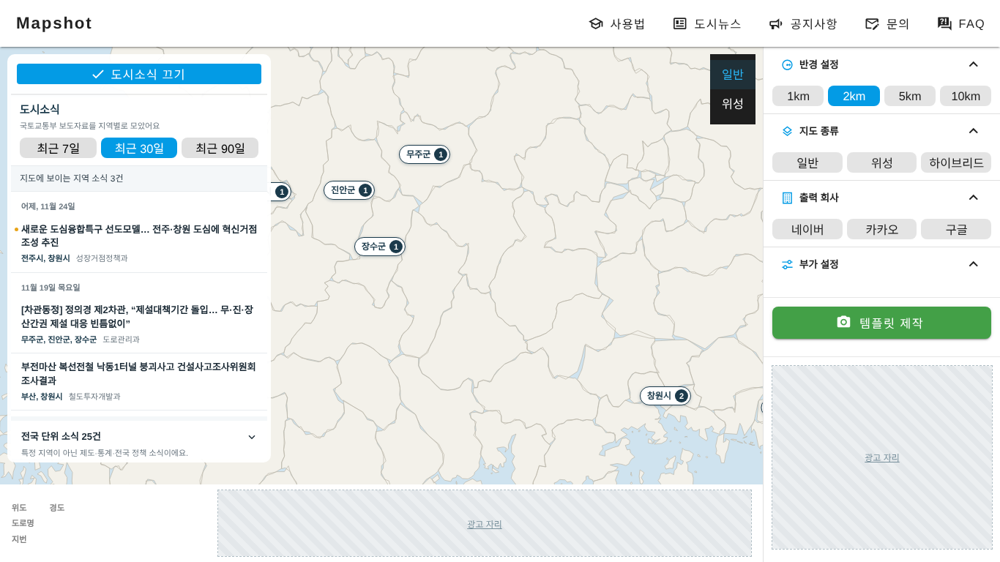
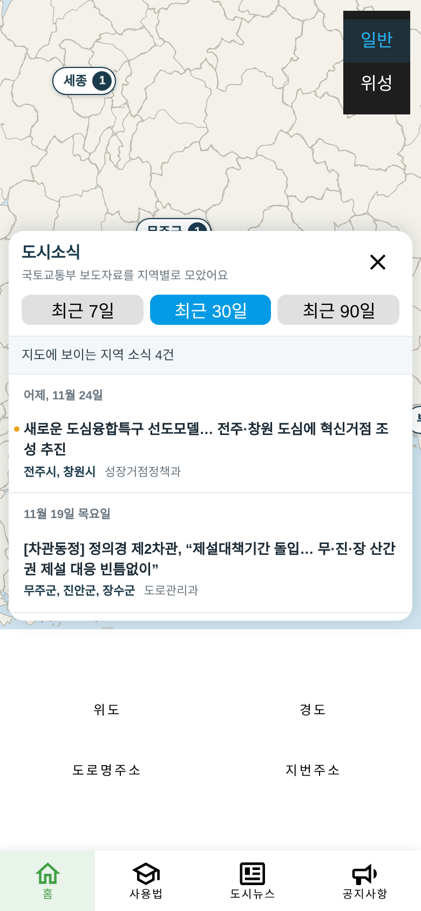

# 도시소식 지도 레이어

> 상태: 1단계 구현 완료, 2단계(보도자료 풀이 글) 구현 중 · 시작: 2026-11-25 · 관련 레포: API, Front
> 브랜치: `Mapshot-API:feat/city-news-map`, `Mapshot-Front:feat/city-news-map`
> 같이 읽기: [explainer.md](explainer.md)(2단계: 보도자료 풀이 글), [flow.md](flow.md)(작동 플로우), [eval/](eval/)(지역 추출 평가), `decisions/2026-11-25-location-rule-scope.md`, `decisions/2026-11-25-remove-parcel.md`

## 왜 하나

1. **새 기능**: 맵샷 사용자는 도시계획 실무자다. 지도를 보다가 "이 동네에 요즘 무슨 사업이 있나"를 같은 화면에서 볼 수 있으면 지도 도구 이상의 이유로 들어올 수 있다.
2. **체류시간 → 광고 노출**: 지금 사용자는 범위 찍고 템플릿 만들고 나간다. 지도 위에서 소식을 눌러보며 머무는 시간이 늘면, 이미 있는 오른쪽(300x250)·하단(728x90) 광고의 노출이 늘어난다. 광고 자리를 새로 만드는 게 아니다.
3. **기존 도시뉴스의 한계 보완**: 도시뉴스 탭은 네이버 뉴스 API 의 제목과 한두 문장 요약만 받아서 내용이 얕고, 무관한 기사가 섞인다(`plans/2026-06-news-ai-digest/README.md` 알려진 문제). 공공 보도자료는 공공누리로 개방돼 있고, 국토부가 직접 쓴 요약(부제)이 붙어 있다.

## 무엇을 만드나

- 지도 왼쪽 패널에 **'지도에서 도시소식 보기'** 버튼(필지 선택하기가 있던 자리).
- 켜면 국토교통부 보도자료가 대상 지역(시군구 또는 시도)에 **'지역명 + 건수' 라벨**로 찍힌다.
- 왼쪽 패널은 소식 목록이 된다. 기본은 '지금 지도에 보이는 지역'의 소식, 라벨을 누르면 그 지역 소식만.
- 항목을 펼치면 국토부 부제(요약 불릿), 원문 링크, '지도에서 보기'.
- 특정 지역이 없는 소식(제도, 통계, 전국 정책)은 지도 대신 패널 아래 '전국 단위 소식'으로.
  → 2단계에서 변경: 지도 패널에서 빼고 도시뉴스 '보도자료 풀이'에서만 보여준다([explainer.md](explainer.md)).

## 범위

이번에 하는 것

- 출처: 국토교통부 보도자료 하나(RSS + 상세 페이지)
- 지역 단위: 시군구(일반구 포함)와 시도. 좌표는 행정구역 대표점
- 기간: 최근 7일 / 30일 / 90일
- 필지 선택하기 기능 제거(같은 자리를 쓰므로)

이번에 안 하는 것

- 본문 기반 요약·일정 추출: 본문(PDF)은 이제 읽지만 지역 추출에만 쓴다. 화면 요약은 국토부 부제 그대로.
- LLM 요약문: 국토부 부제가 이미 공식 요약이라 그대로 보여준다. LLM 이 지어낼 위험을 안 만든다.
- 다른 출처(토지이음 고시, 지자체 보도자료): 아래 '남은 일' 참고.
- 도시뉴스 탭과의 통합: 일단 별개로 둔다.

## 화면

> 스크린샷은 미리보기 환경에서 찍었다. 카카오맵 대신 시군구 경계를 그린 대역 지도, 웹폰트 대신 시스템 폰트, 광고는 빗금 자리로 표시.
> 데이터는 2026-11-16~25 실제 국토부 보도자료 30건에 손으로 지역을 단 것.

| 상태 | 화면 |
|---|---|
| 켠 직후, 전국 축척(시도 단위로 묶임) |  |
| 확대(시군구 단위) |  |
| 라벨 선택 + 항목 펼침 |  |
| 전국 단위 소식 펼침 |  |
| 노트북 1366x768 |  |
| 모바일 |  |

화면 원칙

- 기존 화면 문법(Vuetify tonal 버튼, `info` 파랑, 나눔스퀘어 네오)을 그대로 쓴다. 새로 들어온 색은 마커·지역명용 짙은 청회색(`#1b3a4b`) 하나, 새 소식 점·선택 배지용 노랑 둘.
- 마커는 핀 아이콘이 아니라 글자 라벨. 시군구 대표점이라 정확한 지점을 가리키는 핀처럼 보이면 오해를 산다.
- 목록은 날짜로 묶는다. 보도자료는 날짜가 맥락이다(조간 배포 등).
- 사흘 안 소식에는 점을 찍는다(다시 들어올 이유).

## 결정

- **좌표는 행정구역 사전으로 정한다.** LLM 은 지명 텍스트만 내고, 서버가 시군구 대표점 테이블(`Mapshot-API:src/main/resources/region/sigungu.csv`, 281행)로 코드·좌표를 정한다.
  - 버린 것: 브이월드 지오코더(결과 DB 저장 금지 조건), LLM 이 좌표를 직접 내기(지어낼 수 있음), 프론트 카카오 지오코딩(매번 같은 결과를 브라우저마다 다시 계산).
  - 대표점 출처: npm `korea-sigungu-geocoding`(MIT)의 시군구 경계에서 계산. 일반구가 있는 시(수원·창원 등 12곳)는 구 대표점 평균으로 시 대표점을 따로 만들었다.
- **모호한 지명은 버린다.** 시도 없이 '중구', '고성군'처럼 여러 곳과 겹치면 찍지 않는다. 틀린 곳에 찍는 것보다 안 찍는 게 낫다.
- **LOCAL 인데 사전에서 하나도 못 찾으면 전국 목록으로 보낸다.** 사라지는 것보다 낫다.
- **LLM 은 수집 회차마다 모아서 1회(10건씩).** 지역 추출 실패 시 `UNKNOWN` 으로 남기고 다음 회차(최근 14일 안)에 다시 시도. `UNKNOWN` 은 화면에 안 보인다.
- **수집 주기는 매시 정각.** 보도자료가 하루 중 수시로 올라오고(11/24 하루에만 7건), RSS 가 최신 10건만 준다. 새 건이 없으면 RSS 1요청으로 끝나서 자주 돌려도 비용이 거의 없다. 처음엔 08~20시 3시간 간격이었는데 새 소식이 늦게 뜬다는 이유로 줄였다(2026-11-25).
- **본문은 PDF 첨부에서 읽는다(PDFBox).** 상세 페이지 본문은 문서뷰어라 HTML 로 안 읽히고, PDF 는 글자 PDF 라 OCR 없이 뽑힌다. 본문은 지역 추출에만 쓰고 화면엔 부제를 보여준다. HWPX 대신 PDF 로 간 이유는 다른 부처·지자체로 넓힐 때 PDF 가 공통이라서. 자세한 내용은 [flow.md](flow.md) '문서를 어떻게 읽나'.
- **줌 레벨 12 이상(전국 축척)에서는 시도 단위로 묶는다.** 시군구 라벨이 겹쳐 읽을 수 없어서.
- **도시소식을 켜면 왼쪽 패널 광고는 숨긴다.** 같이 두면 900px 높이 화면에서도 목록이 2건밖에 안 보였다(미리보기에서 확인). 목록이 보여야 체류가 생긴다. 오른쪽·하단 광고는 그대로 노출된다. 숨길 때는 기존 규칙대로 `v-show`.
- **필지 선택하기는 제거.** `decisions/2026-11-25-remove-parcel.md`

## 미리 확인한 것

- 국토부 보도자료 RSS: `https://www.molit.go.kr/dev/board/board_rss.jsp?rss_id=NEWS` (최신 10건). `description` 은 문서뷰어 iframe 이라 안 쓴다.
- 상세 페이지 구조: 제목 `h4`, 부제 `ul.bd_view_ul_lst > li`(첫 줄 【관련 국정과제】는 제외), 담당부서 `ul.bd_view_ul_info`, PDF·HWPX 첨부 링크.
- robots.txt: `/dev/board`, `/USR/NEWS` 경로는 막혀 있지 않다(2026-11-25).
- 라이선스: 국토부 보도자료는 공공누리로 개방. 화면에 출처(국토교통부)와 원문 링크를 같이 둔다.
- **지역이 특정되는 비율이 낮다.** 2026-11-16~25 보도자료 30건 중 지역이 제목·부제에 나온 건 6건(20%). 국토부만으로는 지도가 듬성듬성하다. → 출처 추가가 다음 과제.

## 확인할 것 / 남은 일

- [x] 로컬에서 API·Front 같이 띄워 실제 카카오맵 위에서 확인(2026-11-25). 이때 고친 것: 켜면 드래그가 안 되던 버그, '지도에서 보기'가 첫 지역으로 튀던 문제, 패널에 가리는 이동, 도시소식 중 지도 클릭으로 캡처 범위가 잡히던 문제
- [x] API `./gradlew test` 통과(2026-11-25, JDK 17)
- [ ] 운영 배포 후 `POST /admin/press/collect` 로 한 번 수집, 지역 추출 결과를 `eval/` 정답과 비교
- [ ] 출처 추가 후보
  - 토지이음 고시정보(도시계획 결정고시 등): 지역이 항상 있다. 공개 데이터는 연 1회 CSV 라, 매일 쓰려면 게시판 수집 가능 여부(약관·robots)부터 확인
  - 지자체 보도자료: 지역은 확실하지만 출처가 많다
- [ ] 체류시간 측정: 켠 횟수, 펼친 항목 수, 원문 클릭 수 이벤트를 남길지 결정(지금은 안 남김)
